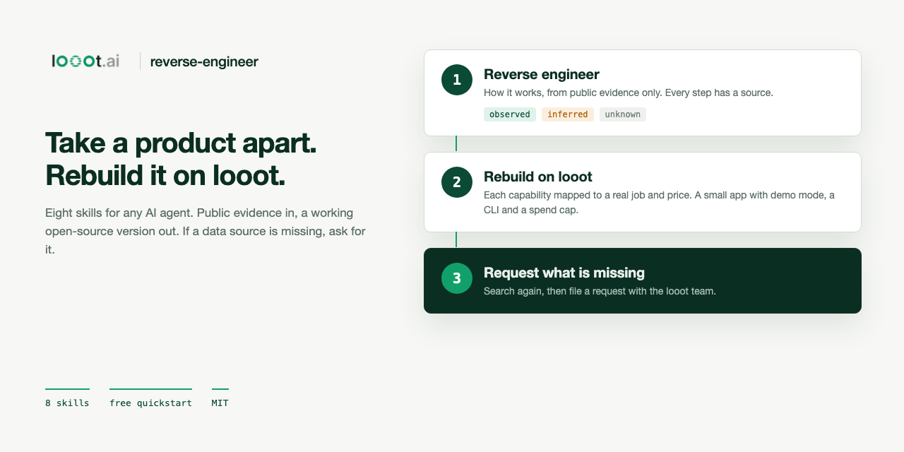
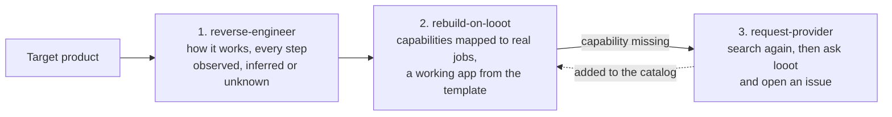
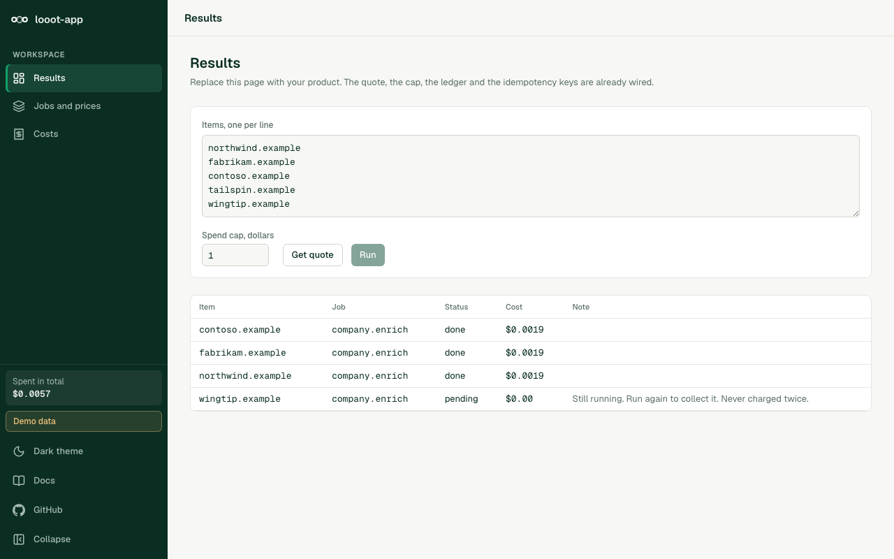

<p align="center"></p>

# reverse-engineer

[](LICENSE) [](https://github.com/loootai/reverse-engineer/releases) [](https://docs.looot.ai)

An open-source skill pack for AI agents. It takes a product apart from the outside using public evidence, rebuilds it as a small app on [looot](https://looot.ai) (one key and one prepaid balance for 2,500+ data API endpoints from 90+ providers), and files a request with the looot team when a data source is missing.



## Install for agents

```bash
claude mcp add --transport http looot https://api.looot.ai/mcp
```

Claude Code plugin (the eight skills and the looot MCP server):

```text
/plugin marketplace add loootai/reverse-engineer
/plugin install reverse-engineer@looot-reverse-engineer
```

Only the skills, for Claude Code, Cursor, Codex and the other agents the [skills CLI](https://github.com/vercel-labs/skills) supports:

```bash
npx skills@1.7.0 add loootai/reverse-engineer
```

With no tools at all, copy the folders:

```bash
git clone --depth 1 https://github.com/loootai/reverse-engineer
cp -R reverse-engineer/skills/* ~/.claude/skills/
```

Agents that read `AGENTS.md` (Codex, Cursor and others) can follow [AGENTS.md](AGENTS.md) with no install. [llms.txt](llms.txt) is the short version.

Skills need no looot account for the free path. A paid looot job needs a sign-in and a funded balance (top up from $5). The agent quotes the price first and never pays for you.

## 60-second quickstart, no paid call

1. Install the skills with one of the commands above.
2. Ask your agent: "Reverse engineer plausible.io, mechanism only, no paid calls."
   It reads robots.txt, the public pages and the public script as text, then writes `reverse/plausible-<date>/report.md` with every step tagged observed, inferred or unknown.
3. Then ask: "Rebuild it on looot, plan only."
   It searches the free catalog, writes a capability map (which part looot covers, which part is plain code, which part is missing) and stops for your yes before any code.
4. To see what a rebuild looks like, run the template. It needs Node 22.12 or newer.

   ```bash
   cd template && npm ci --ignore-scripts && npm run demo   # http://localhost:3600, sample data, no token
   ```



The free path uses plain GETs of public pages and two free catalog reads: `GET https://api.looot.ai/v1/catalog/overview?depth=jobs` and `GET https://api.looot.ai/v1/public-catalog?q=<words>`. No token and no balance are involved.

## The eight skills

| Skill | Say something like | What it does |
| --- | --- | --- |
| [`reverse-engineer`](skills/reverse-engineer/SKILL.md) | "reverse engineer X", "how does X work", "take X apart" | The orchestrator. Scope and cap, probe, teardown, mechanism, research, snapshot, audit, then what the mechanism needs. |
| [`rebuild-on-looot`](skills/rebuild-on-looot/SKILL.md) | "rebuild this on looot", "build an open-source version of X" | Maps each capability to real looot jobs with prices, marks it covered, partly covered, own code or missing, drops what does not fit, scaffolds the app from `template/`. |
| [`request-provider`](skills/request-provider/SKILL.md) | "looot does not have this", "request a provider" | Searches again with several phrasings, then files a capability request with looot and, with your yes, a GitHub issue. |
| [`bounded-probe`](skills/bounded-probe/SKILL.md) | "test this on a few first", "how much will 500 leads cost" | A tiny capped run: hit rate, real cost per row, a projection and a go, change or stop. |
| [`site-teardown`](skills/site-teardown/SKILL.md) | "teardown this site", "what is acme.com running" | Pages, positioning, pricing, stack, hiring, ads and search footprint of a public site. |
| [`evidence-research`](skills/evidence-research/SKILL.md) | "research this company", "back this up with evidence" | A findings ledger. Each claim carries a tag, a source and a cost. |
| [`competitor-diff`](skills/competitor-diff/SKILL.md) | "what changed at competitor.com", "save a baseline" | Dated snapshots and a diff, so nothing is paid for twice. |
| [`claims-audit`](skills/claims-audit/SKILL.md) | "audit this report", "what am I assuming here" | Finds claims no source backs, prices the checks, reports the error rate of a sample. |

## Limits

These are rules in every skill, not suggestions.

- Public information only.
- No logging in to an account you do not own, and no use of anyone else's credentials.
- No bypassing an access control, paywall, rate limit or bot block.
- No running untrusted code. Public scripts are read as text and never executed.
- No scraping behind a login. No signing up, no forms, nothing sent to the target.
- Respect robots.txt and the terms of every page.
- No copying code, text, logos or screenshots. Facts and ideas are fine. Expression is not.
- No trademark confusion. A rebuild says "an open-source alternative to X" once, with X's public price and the date read, and says it is not affiliated with X.
- No profiling of private individuals. Anything that identifies a person needs a lawful basis and consent, and ships off by default.
- This is not legal advice. Check your own situation, and the target's terms, before you rely on any of it.

## Examples

Three real cases, written from the research and the repos. Each lists the mechanism with tags, the capability map with job ids and list prices, what was dropped, what was missing and the cost of a typical run.

| Case | Rebuild | Typical run at list price |
| --- | --- | --- |
| [RB2B to looot-reveal](examples/rb2b-to-looot-reveal.md) | [looot-reveal](https://github.com/loootai/looot-reveal) | about $0.08 per 100 new IPs |
| [6sense to looot-intent](examples/6sense-to-looot-intent.md) | [looot-intent](https://github.com/loootai/looot-intent) | $0.1720 per account |
| [Gojiberry to looot-warm-leads](examples/gojiberry-to-looot-warm-leads.md) | [looot-warm-leads](https://github.com/loootai/looot-warm-leads) | up to $0.25 per run, $0.65 with hiring and funding |

No paid looot run was made for any of the three rebuilds. Their own READMEs say which parsers were built from docs and fixtures.

## When something is missing from looot

`request-provider` does this in order.

1. It searches the catalog with at least four phrasings. Gaps reported after one search often exist under other words.
2. It checks whether a job that exists can do most of it.
3. It writes the request and shows you the text. Nothing is sent without your yes.
4. It files the request through looot's documented route, the `capability_request` MCP tool or `POST /v1/capability-requests`, with a stable idempotency key. That route is described in the [looot docs](https://docs.looot.ai/support). It needs a signed-in token.
5. It can also open a public [Provider request](https://github.com/loootai/reverse-engineer/issues/new?template=provider-request.yml) issue here, after it searches for an existing one so you can add a thumbs-up instead of a duplicate.

What happens next, and only this: the looot request route records the request for the looot team, and an issue here is read by the looot team. Neither route promises that a provider is added or when. The skill tells you to search again later.

Never put tokens, keys, customer names or personal data in a request. The GitHub issue is public.

## Check the repo

```bash
npm run check
```

`npm run check` lints every `SKILL.md`: frontmatter present, `name` matches the folder, the description has trigger phrases, no internal paths, no em dashes, no unpinned `npx`, every relative link resolves, and every `job:<id>` in the repo exists in the live looot catalog. It reads the catalog once. Use `npm run check:offline` to skip that part.

The template has its own checks: `cd template && npm test && npm run typecheck && npm run lint && npm run build`.

## Status

- Tested by hand: `claude plugin validate` passes on the marketplace and plugin manifests, `npx skills@1.7.0 add <path> --list` lists all eight skills, and the template passes its tests, typecheck with a clean cache, lint and build, and its demo returns 200.
- The free path of `reverse-engineer`, `rebuild-on-looot` and `request-provider` was followed by hand on one public target, up to the first paid step and up to the confirmation step of a request. No real issue or request was filed.
- Not tested: the plugin install itself, Codex and Cursor, and any paid looot run from these skills. Prices in the skills are list prices read on 2026-10-11, and `inspect` shows the live number.
- `npm audit` on the template reports 0 vulnerabilities in production dependencies. The dev chain (`eslint-config-next`, `braces`) reports 5 high findings with no patched version published. They run during `npm run lint` only.

## Contributing

Read [CONTRIBUTING.md](CONTRIBUTING.md). Run `npm run check` before you open a pull request. A new skill needs a folder under `skills/`, a `SKILL.md` that passes the check, and an example run.

## Licence

MIT, copyright looot. See [LICENSE](LICENSE). Built on [looot](https://looot.ai): terms at https://looot.ai/terms, privacy at https://looot.ai/privacy. Names of other products are used to say what a rebuild is an alternative to. This project is not affiliated with any of them.

See also [looot-skills](https://github.com/loootai/looot-skills) (single-job skills), [looot-plugin](https://github.com/loootai/looot-plugin) and [awesome-looot-use-cases](https://github.com/loootai/awesome-looot-use-cases).
